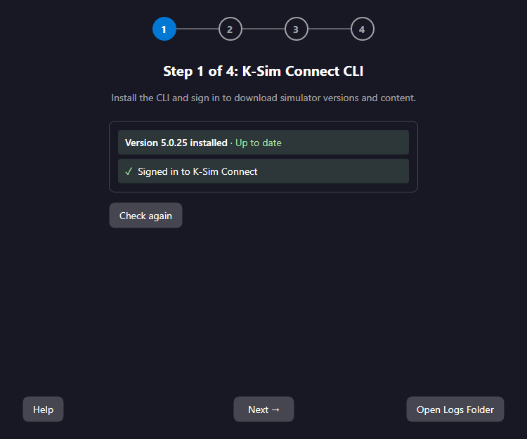
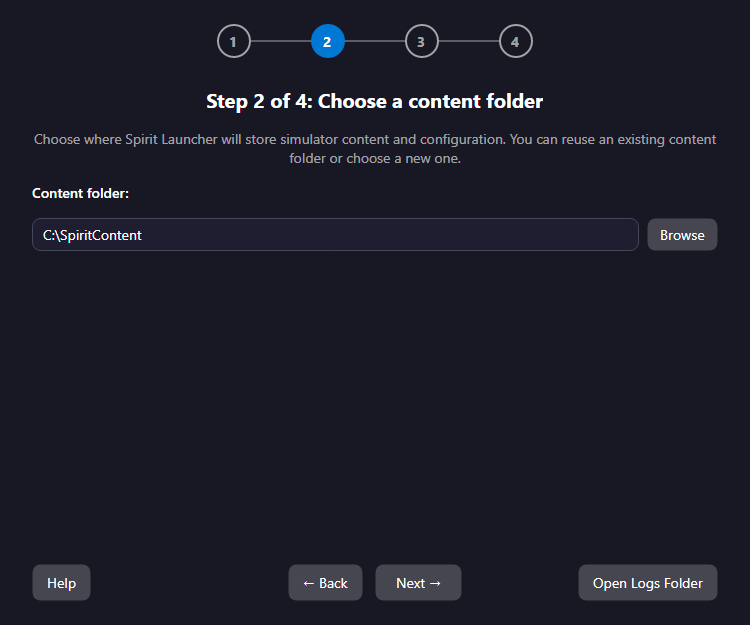
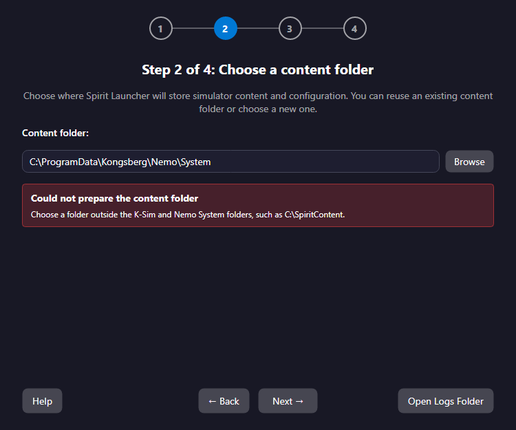
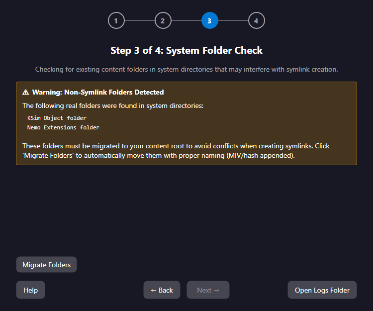
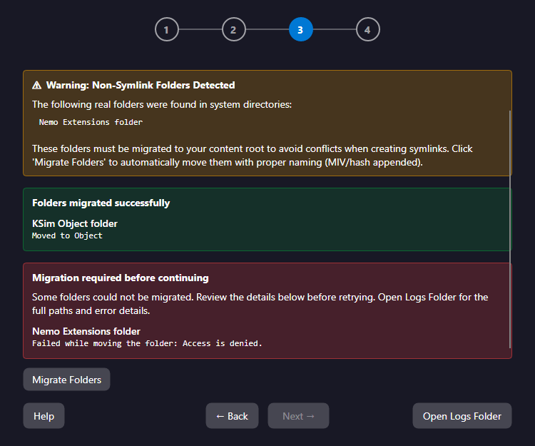
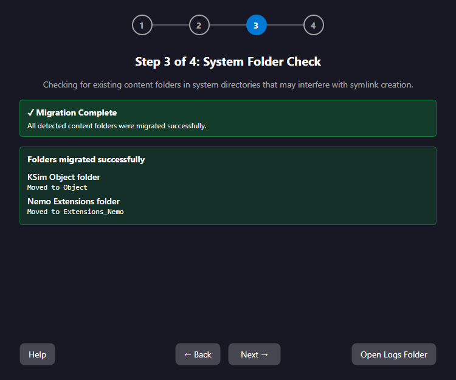
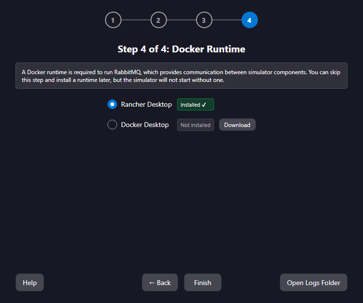

# Onboarding

Spirit Launcher walks you through four steps the first time you set it up.

## Step 1: K-Sim Connect CLI

If the CLI is missing, select **Get the CLI** to open the installer page. After installing it, select **Check again**. If you're not signed in, select **Sign in** and follow the prompts in your browser.

The screen shows the installed version and your sign-in status. **Update to …** appears only when the launcher confirms a newer version is available. You can select **Next** once the CLI is installed and you're signed in, even if the launcher couldn't check for updates.

## Step 2: Choose a content folder

Choose where Spirit Launcher will store simulator content and configuration. You can reuse an existing content folder or choose a new one. Pick a location with enough space for the content you plan to download. Spirit Launcher creates the folders it needs.

Don't select a folder inside the K-Sim or Nemo `System` folders. Use a separate location, such as `C:\SpiritContent`. If setup can't prepare the folder, it stays on this step and explains why. Correct the path or use **Browse**, then select **Next** again.

## Step 3: System Folder Check

Spirit Launcher checks for existing content folders in the K-Sim and Nemo system directories where it needs to create links. If there are no conflicts, select **Next**. If setup lists folders, review them before selecting **Migrate Folders**. This **moves** them to the content folder you chose in Step 2. If another installation or custom build still uses those folders in their current location, confirm that moving them is intended before proceeding.

If setup reports a problem, scroll to read the details. **Migrate Folders** and the navigation buttons stay visible. Setup checks the destinations before moving anything; if it rejects a path, go **Back** and choose a different content folder. After a copy or source-cleanup failure, check both locations before retrying. Don't delete either copy just to clear the warning.

Select **Next** once the conflicts are resolved. When setup successfully moves the folders, it shows **Migration Complete**.

## Step 4: Docker Runtime

Choose a supported Docker runtime so RabbitMQ can run when Spirit starts. If neither runtime is installed, select **Download** or select **Finish** and install a runtime later. Use Rancher Desktop if you don't have an approved Docker Desktop licence.

## If you need help

Select **Open Logs Folder** in setup or in the launcher's log viewer. If you need to share the error, copy `launcher.log` **before starting Spirit Launcher again**: the newest run replaces the previous log. Migration failures include the operation and paths that were involved, plus a Windows error code when available.
