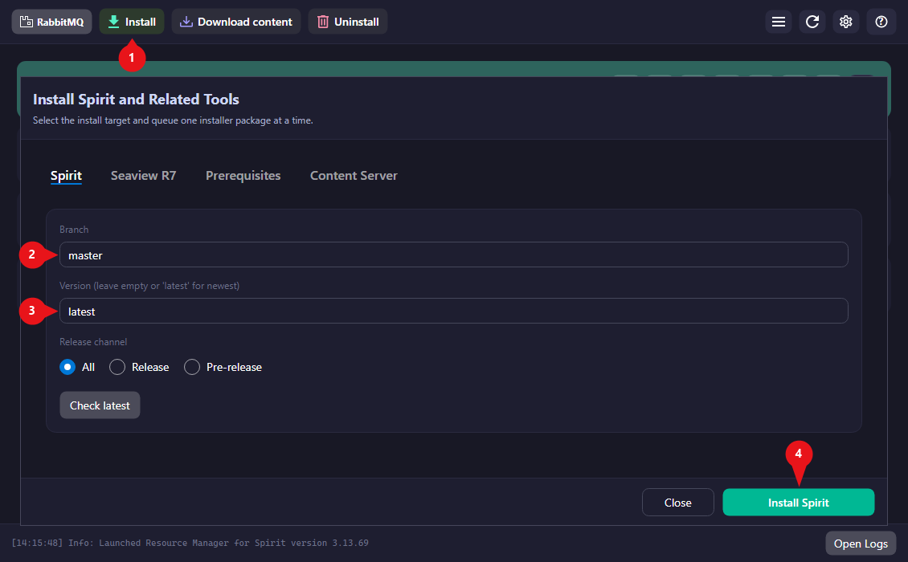
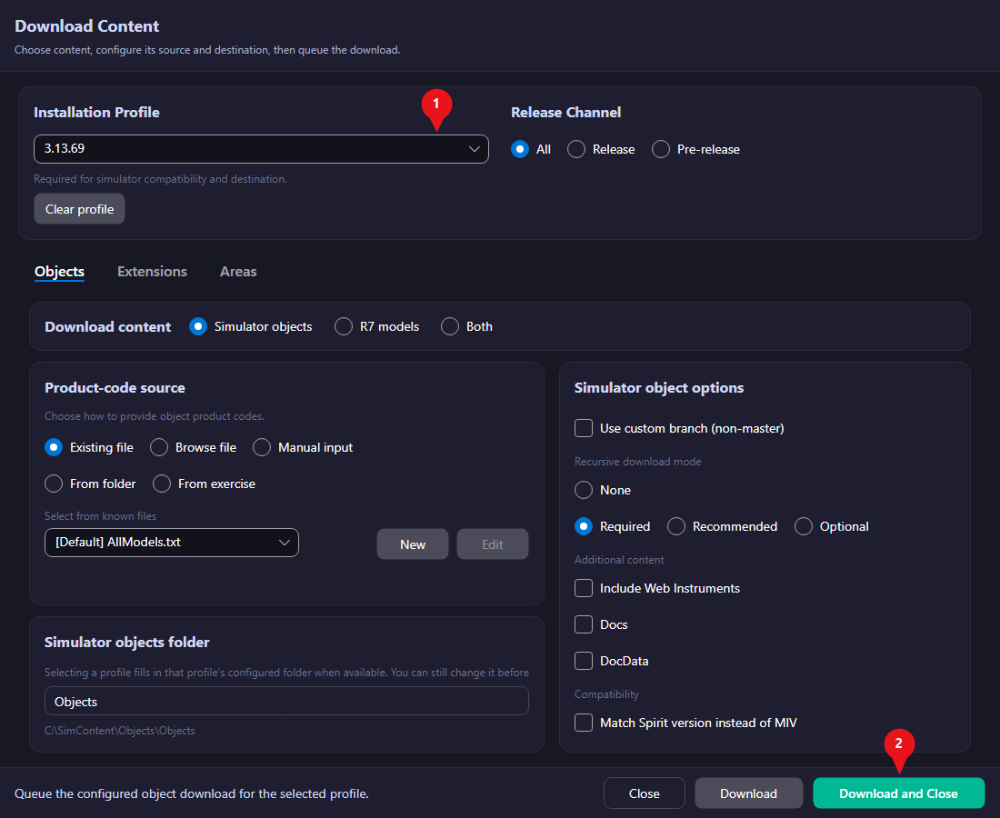
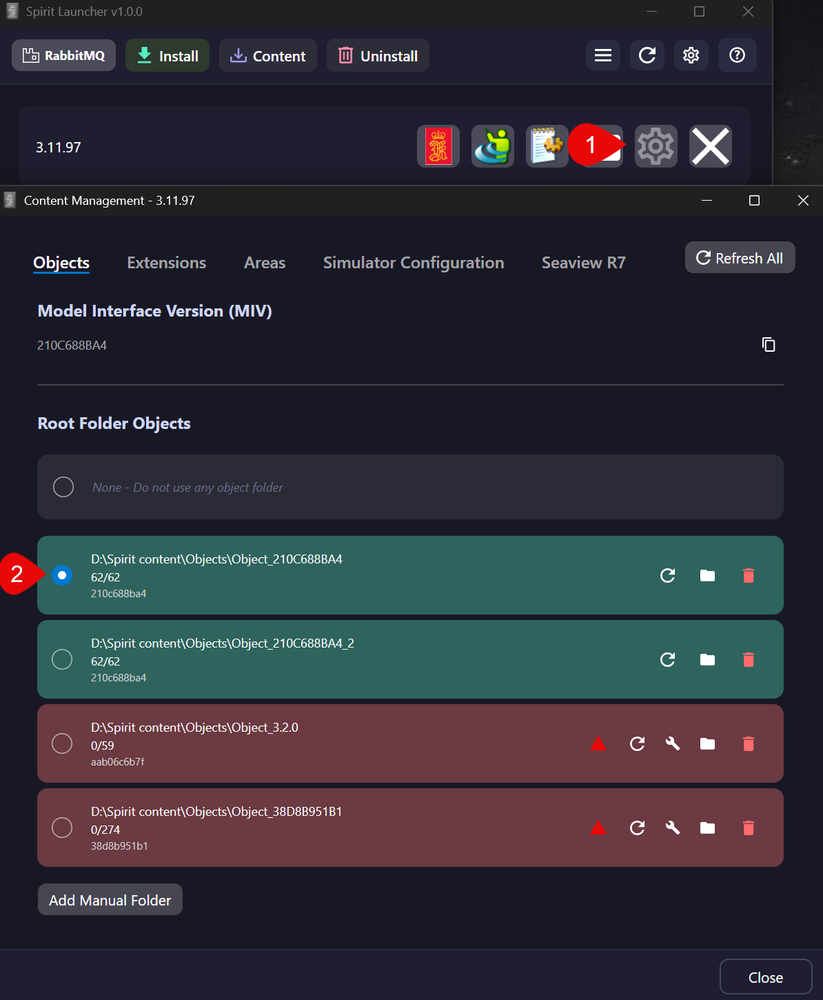
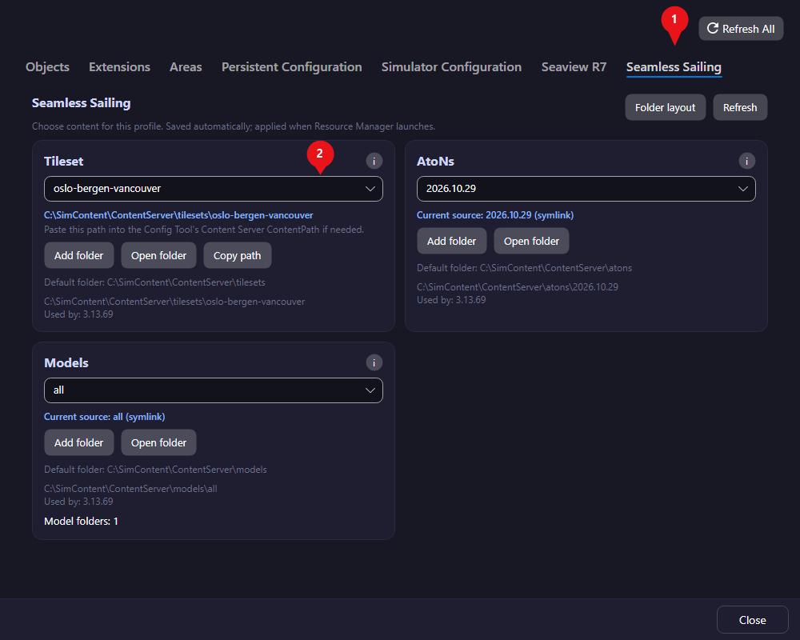
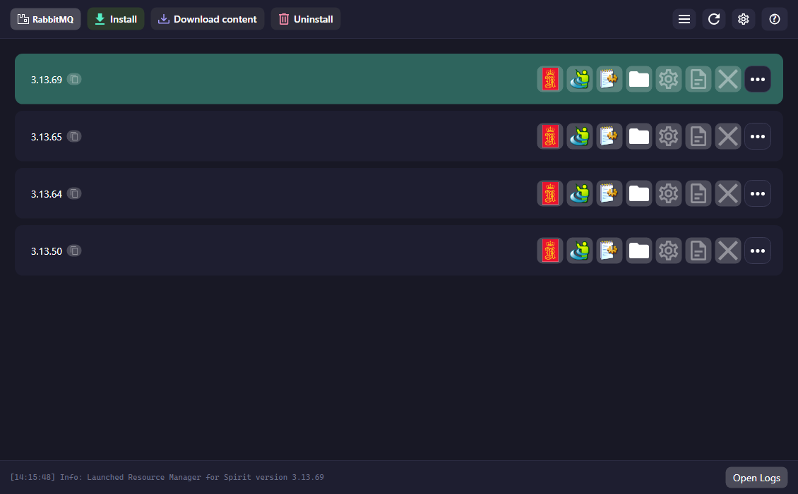
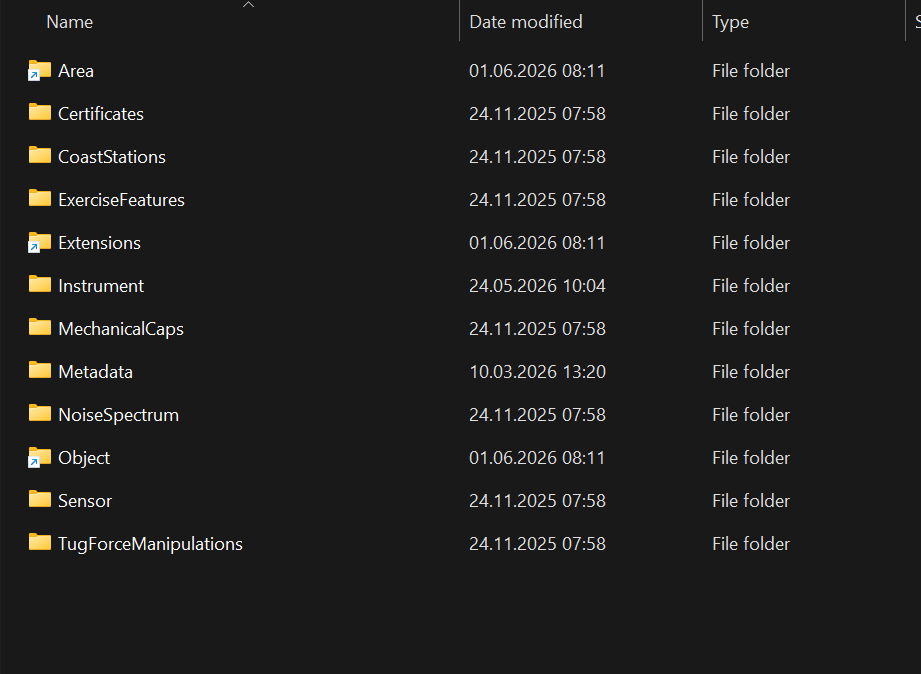

# Quick Start

This guide covers the shortest path to getting a Spirit version installed, started, and supplied with content.
Use it when you want the main workflow only.

## 1. Download Spirit

Open Spirit Launcher and click Install (1).
Use the Spirit tab, choose the branch (2) you need, and leave the Version (3) as **latest** to get the latest build unless you need a specific one.
Click Install Spirit (4) to download and install that version of spirit. All downloaded installers will automatically be cleaned up after installation. 

## 2. Download Content

Open Download Content and choose the installation profile (1) you want to prepare.
Download the Objects, Extensions, or Areas you need from the relevant tab, then click Download and Close (2).
The queue shows progress, and downloaded content is placed under your configured content root.
R7 models are downloaded into a collection folder, for example `ContentServer\models\all`.

## 3. Manage Content For a Version

Click the gear button on a profile to open its profile settings.
Select the object, extension, and area folders you want that version to use.
Re-validate or fix incompatible folders when needed.

For R7, open the Seamless Sailing tab (1) and choose a tileset (2), AtoNs, and a model collection. Select the folder itself, such as `ContentServer\tilesets\<tileset>`, not `ContentServer`. They are linked into the tileset when Resource Manager starts.
Close the window to keep working with that version.

## 4. Start Spirit

Use the Kongsberg button on the version card to launch Resource Manager for that installed version.
Wait until the version is fully loaded and ready before starting related tools.
If the simulator depends on Docker and RabbitMQ, make sure your selected runtime is installed and running.
A running version is indicated with a green background. 

When resource manager is started, Spirit Launcher creates a symlink from the selected Object, Extension and Area folder for the version started to C:\ProgramData\Kongsberg\KSim\System
The Symlinked folder will have a arrow in the folder icon. From spirit point of view its like the folders are there, but in reality they live inside the content root folder. 
Any changes made to the content root folder applies to the content in the linkes folder. 

## 5. View Logs

Click the document button on the version card to open **Logs** for that profile. The window stays open while you keep working.
For R7 it shows the Content Server log, the instructor (3DView) log, and one log per student station, and follows them live.

To look at another log, click **Open log file...** at the top of the window and choose any `.log` or `.txt` file. It opens as a new tab.
To have your own log files appear in every profile's log window, add them to `AdditionalLogSources` in `settings.json`. See [Profile logs](../user_manual/user-manual.md#profile-logs) in the user manual.
