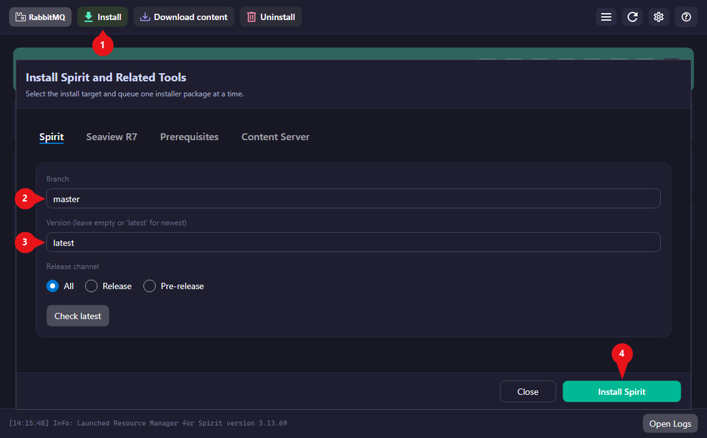
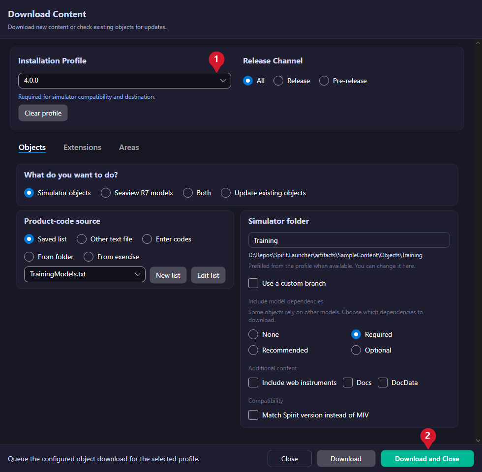
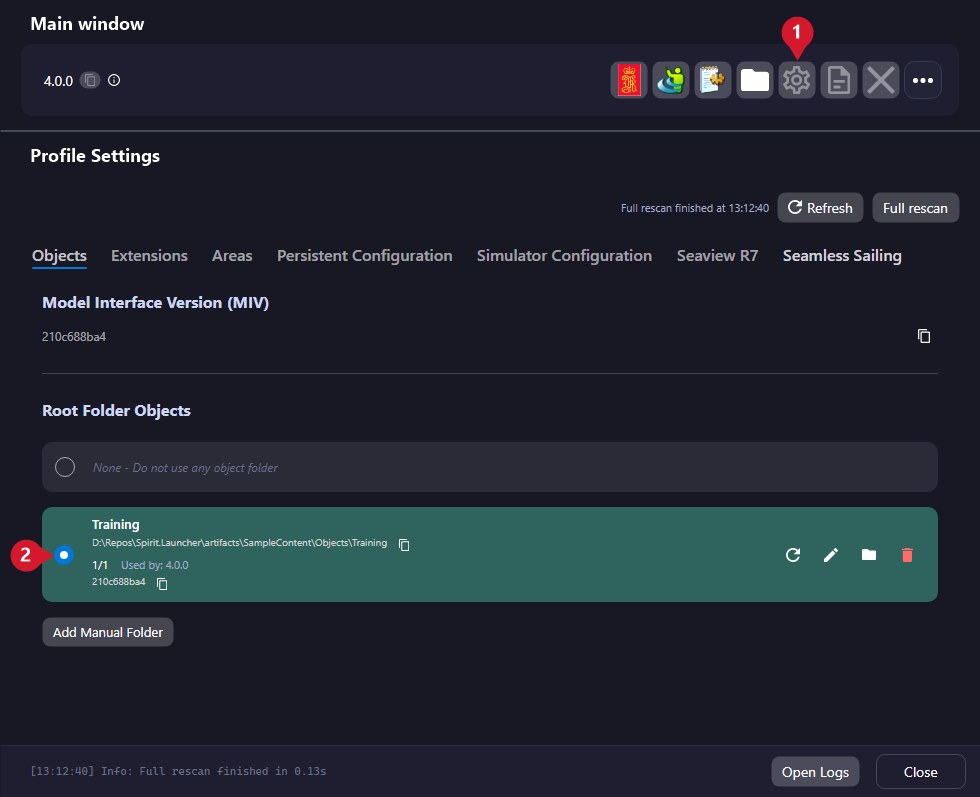
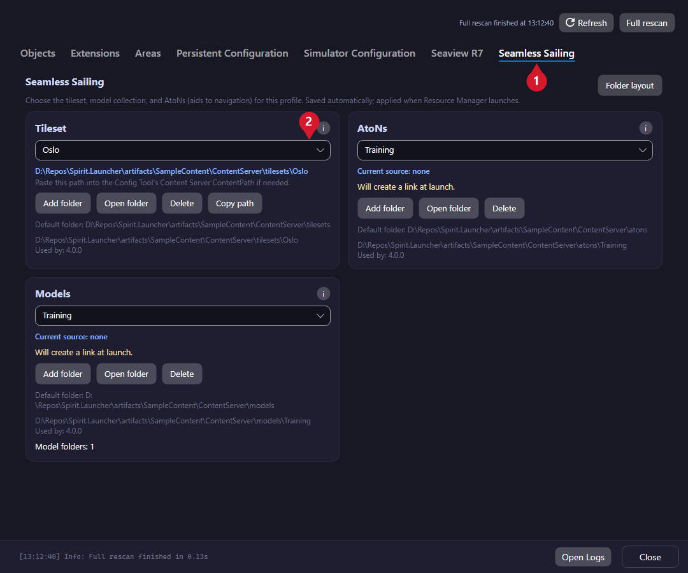
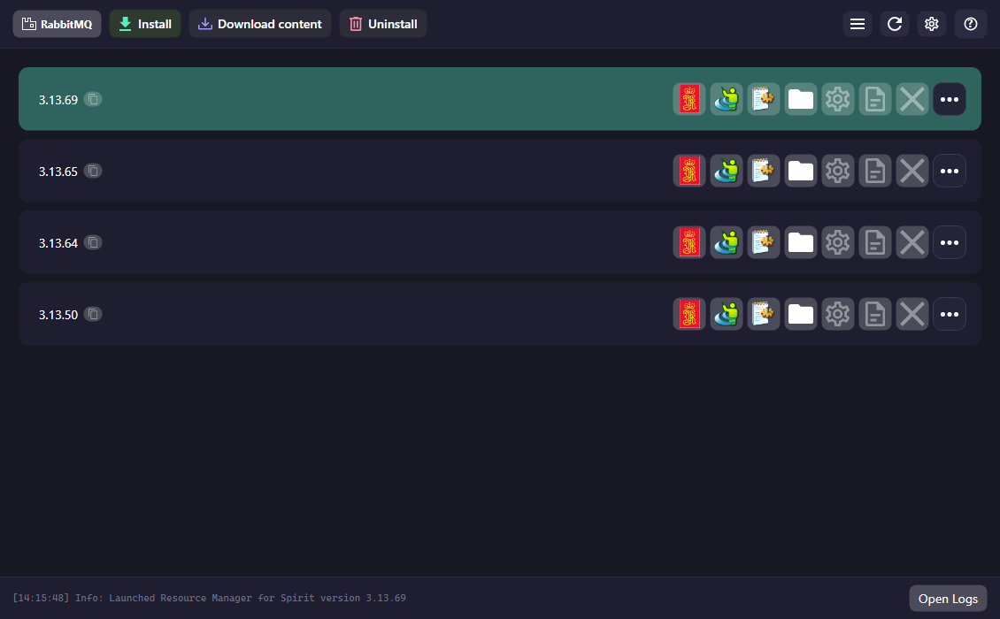
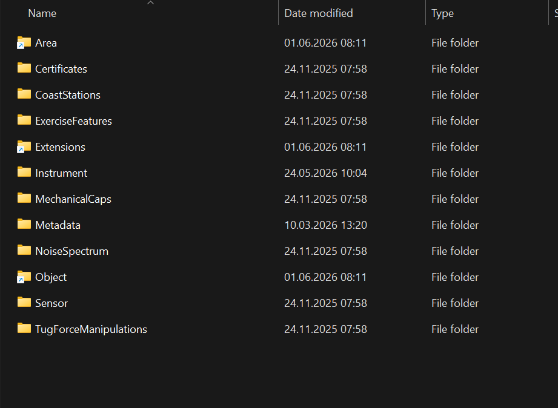

# Quick Start

This guide covers the shortest path to getting a Spirit version installed, started, and supplied with content.
Use it when you want the main workflow only.

## 1. Download Spirit

Open Spirit Launcher and click Install (1).
Use the Spirit tab, choose the branch (2) you need, and leave the Version (3) as **latest** to get the latest build unless you need a specific one.
Click Install Spirit (4) to download and install that version of spirit. All downloaded installers will automatically be cleaned up after installation. 

## 2. Download Content

Click **Download content** to open the download window, then select **Objects**, **Extensions**, or **Areas**. On **Objects**, choose **Simulator objects** for Spirit content, **Seaview R7 models** for visual models, or **Both** if you need both.
Choose the **Installation Profile (1)** for simulator content. If you're downloading only Seaview R7 models, skip the profile and choose a collection folder, for example `ContentServer\models\all`.
Choose a source, check the destination, and click **Download and Close (2)**. Follow progress in the queue.

If the models are already on disk, see [Update existing objects](../user_manual/user-manual.md#update-existing-objects) instead.

## 3. Manage Content For a Version

Click the **Profile settings** gear **(1)** on the profile's card in the main window.
On **Objects**, select the folder you want the profile to use **(2)**. Use the **Extensions** and **Areas** tabs to select their folders the same way.
Re-validate or fix incompatible folders when needed.

For R7, open **Seamless Sailing (1)** and choose a **Tileset (2)**, an AtoN source, and a model collection. Select the tileset folder itself, such as `ContentServer\tilesets\<tileset>`, not `ContentServer`. The selected AtoN and model folders are linked into the tileset when Resource Manager starts. For the executable and command-line arguments, use the separate [Seaview R7 tab](../user_manual/user-manual.md#seaview-r7-tab).
Close the window to keep working with that version.

## 4. Start Spirit

Use the Kongsberg button on the version card to launch Resource Manager for that installed version.
Wait until the version is fully loaded and ready before starting related tools.
If the simulator depends on Docker and RabbitMQ, make sure your selected runtime is installed and running.
A running version is indicated with a green background. 

When resource manager is started, Spirit Launcher creates a symlink from the selected Object, Extension and Area folder for the version started to C:\ProgramData\Kongsberg\KSim\System
The Symlinked folder will have a arrow in the folder icon. From spirit point of view its like the folders are there, but in reality they live inside the content root folder. 
Any changes made to the content root folder applies to the content in the linkes folder. 

## 5. View Logs

Click the document button on the version card to open **Logs** for that profile. The window stays open while you keep working.
For R7 it shows the Content Server log, the instructor (3DView) log, and one log per student station, and follows them live.

To look at another log, click **Open log file...** at the top of the window and choose any `.log` or `.txt` file. It opens as a new tab.
To have your own log files appear in every profile's log window, add them to `AdditionalLogSources` in `settings.json`. See [Profile logs](../user_manual/user-manual.md#profile-logs) in the user manual.
